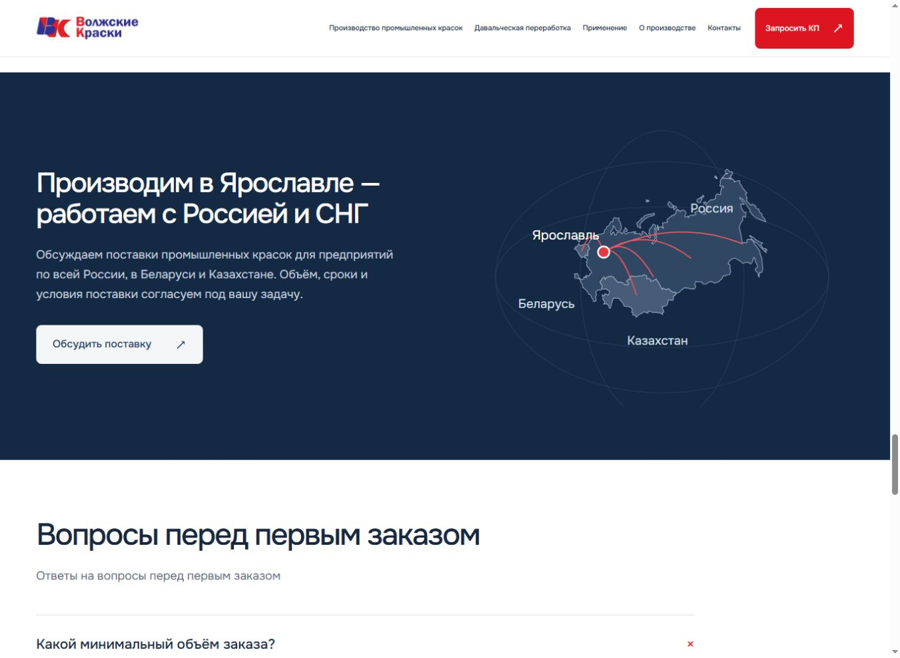
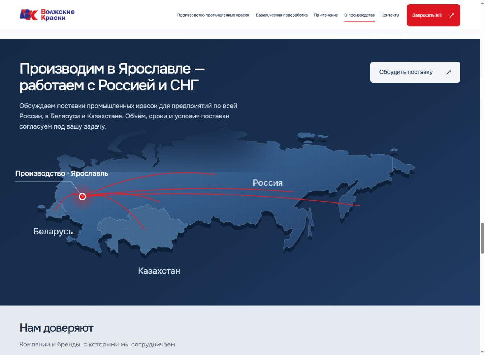
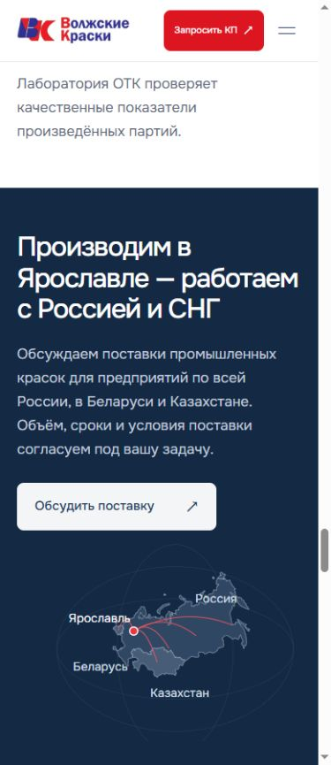
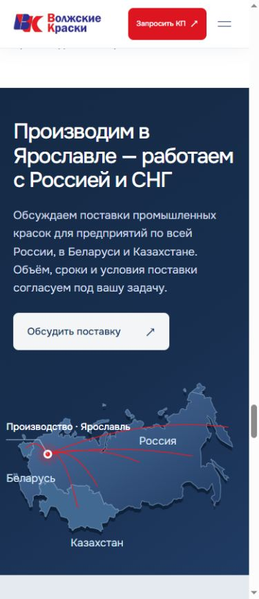

# Географический баннер — 13 октября 2026

Карта стала главным визуальным объектом цельной широкой секции. На десктопе баннер адаптивно занимает 650–800 px по высоте, географический слой — до 2200 px по ширине. Очертание России занимает около 78% этого слоя. Текст компактно расположен сверху слева, CTA — в свободной области справа. Эллипсы удалены; глубина создаётся смещённым нижним слоем, спокойным градиентом и лёгкой сеткой внутри суши. Географическая поверхность мягко затухает за текстом.

На телефоне используется отдельная ортографическая проекция: текст и CTA сверху, более высокая карта ниже. Это отдельная SVG-композиция тех же исходных стран, без уменьшения широкого десктопного рисунка до мелкой картинки. Desktop использует равнопромежуточную цилиндрическую проекцию со стандартной параллелью 50°N, с продолжением восточных долгот за линией перемены дат. Источник контуров сохранён: Natural Earth 1:110m, public domain; данные в docs/map-data/countries.json, генератор scripts/build-map.mjs. Это художественная географическая схема, не юридическое описание границ.

Единственный узел — производство в Ярославле (39.893°E, 57.626°N), со связанной подписью. Дуги показывают условные направления сотрудничества, без вымышленных клиентов, филиалов и складов. Текст географии, услуга lkm, контекст «Поставка в мой регион» и кнопка «Обсудить поставку» сохранены. Секция партнёров остаётся отдельной после карты; обычная версия скрывает пустую конфигурацию, ?preview=partners показывает отмеченные серые слоты.

## Проверки
- 390, 768, 1366, 1920, 2560 px: без горизонтального переполнения; все четыре подписи в пределах баннера. Ширина очертания РФ соответственно около 330, 586, 1063, 1495, 1713 px.
- CTA не пересекается с маршрутами; открывает единственную форму с правильными услугой и контекстом. Escape закрывает её.
- Появление поверхности, точки и последовательное рисование маршрутов — один раз. После возврата поверхность остаётся opacity:1, маршрут полностью видим; перезапуска нет.
- Reduced motion и отсутствие JS оставляют полноценную статичную карту с подписями. При переключении reduced motion класс анимации удаляется, чтобы последующее разрешение движения не скрывало готовую карту.
- npm test: 9 тестов; статическая сборка и сборка GitHub Pages, git diff --check.

## Сравнение
| Экран | До | После |
|---|---|---|
| Desktop, 1366 px |  |  |
| Mobile, 390 px |  |  |

Прежние кадры сделаны на локальном сервере из HEAD до этой правки, без JS, чтобы сохранить видимость старой схемы. Новый баннер снят в режиме preview=partners. Исходные референсы в репозиторий не включены. Форма без backend и согласованные реальные логотипы ожидаются, как прежде.
